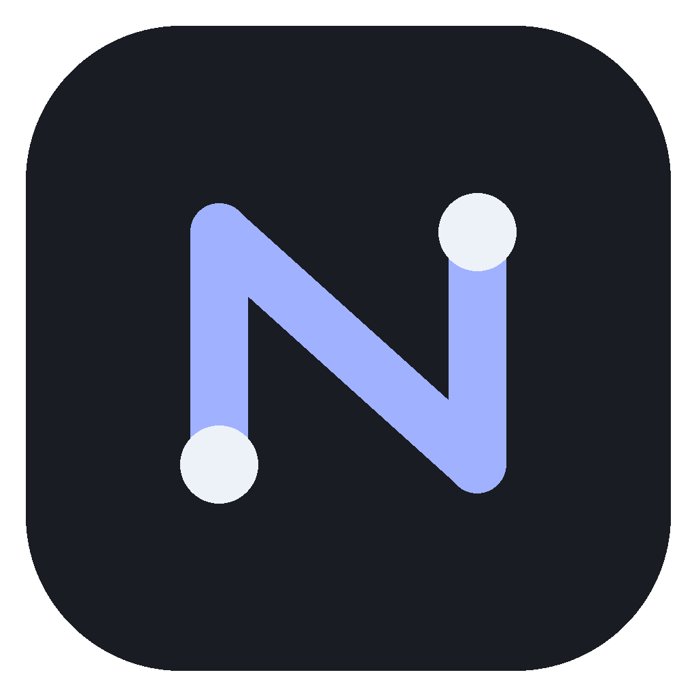

<div align="center">
  
  <h1>Nodi</h1>
  <p><strong>Your files. Your devices. One local network.</strong></p>
  <p>Encrypted file transfer between macOS and Android — without cloud storage or accounts.</p>

[](https://github.com/NODEPY/nodi/actions/workflows/go.yml)


[](LICENSE)

[Downloads](https://github.com/NODEPY/nodi/releases) · [What's new](CHANGELOG.md) · [Testing](TESTING.md) · [CLI](docs/CLI.md) · [Security](SECURITY.md)
</div>

---

## Meet Alpha 3

Connect over Wi-Fi, confirm the matching code and start sharing. QR pairing stays
available as an alternative. Android now has dedicated **Connections**, **Receive**
and **Send** tabs, with refreshed received-file cards and Open/Share actions.

| Connect | Transfer | Stay in control |
| --- | --- | --- |
| Discover devices on your LAN | Send multiple files in sequence | Confirm a new connection |
| Start pairing from either device | Preview received images on Android | Cancel selection or transfer |
| Keep QR as an alternative | Choose your destination folder | Remove saved devices |

**Experimental alpha:** LAN only; no independent security audit.
See the known limitations and test status below before relying on a build.

## Quick start

1. Install Nodi on your Mac and Android phone and connect both to the same local network.
2. Open Nodi on both devices. Find the other device over Wi-Fi and start connecting.
3. Compare the displayed codes and confirm on both screens, or scan the Mac QR on Android.
4. On the receiving device, choose a folder and enable receiving. Select files on the sender.

Android discovery and pairing work before selecting a receiving folder.
Install the Android APK over your existing installation to retain app data when signatures match.
The macOS archive contains `Nodi.app`; current builds are ad-hoc signed, not notarized.

## Versioning

This source version is **1.0.0-alpha.3** (tag `v1.0.0-alpha.3`).
See Downloads for published builds.
Use `MAJOR.MINOR.PATCH-alpha.N` for prereleases and `MAJOR.MINOR.PATCH` for stable releases.
Android `versionName` matches the release version; `versionCode` increases for each distributed build (this build: 3).
macOS uses numeric `CFBundleShortVersionString = 1.0.0` and `CFBundleVersion = 6`;
its release tag identifies the alpha. Increase the build number for each distributed build.
Go **1.22** is the minimum language/toolchain requirement in `go.mod`, not the app version.
Go 1.23.2 in earlier testing notes described a test environment, not a separate requirement.
Use a maintained Go toolchain for release builds; minimum-version compatibility still needs testing.

## Features

- QR pairing and Wi-Fi pairing with comparison-code confirmation; mDNS discovery.
- A connection request can start on either device; the other shows a confirmation prompt.
- Android tabs: Connections, Receive and Send.
- Discovery and pairing do not require an Android destination folder; receiving files does.
- Sequential multi-file sending, cancellation and receiving into a chosen folder.
- Android received-file preview, Open and Share actions.
- TLS 1.3, certificate fingerprint checks and SHA-256 verification.
- Existing files are not overwritten; up to two incoming transfers and 2 GiB per file.

## Build

macOS: macOS 12+, Go 1.22+ and Xcode Command Line Tools.
Run `bash scripts/run-macos.sh`.
The script currently hard-codes the MacOSX26.5 SDK path; another SDK installation may require adjusting it.

Android: minSdk 29, compileSdk/targetSdk 37. Open `android/` in Android Studio,
or run `bash ./gradlew assembleDebug` inside that directory with Android SDK and compatible JDK installed.
The APK is `android/app/build/outputs/apk/debug/app-debug.apk`.

## Pairing and receiving

Open Nodi on both devices on the same LAN. Use Find in Wi-Fi, select the discovered
peer and start connecting. Compare the displayed codes and approve on both screens.
QR remains an alternative: show the Mac pairing QR and scan it on Android.
Discovery alone does not establish trust.
On Android select a destination folder and enable receiving only when files are needed.
On Mac the destination can be changed while the receiver is running; the receiver restarts.

## Limitations

No cross-network connection, folder transfer, resume or remote file browsing.
The Go receiver requires a destination filesystem supporting hard links (for example APFS;
FAT/exFAT do not). Android uses a document-provider folder and has separate permission semantics.
macOS builds are ad-hoc signed, not notarized; Android alpha builds use debug signing.
For known test gaps and the device checklist, see [TESTING.md](TESTING.md).

## Checks

```bash
go vet ./...
go test -race ./...
python3 scripts/check-core.py
```

See [CLI documentation](docs/CLI.md). Windows, Linux desktop apps, cross-network
connections, folder transfer and resume remain roadmap items.

## License

Apache-2.0. See [LICENSE](LICENSE).
