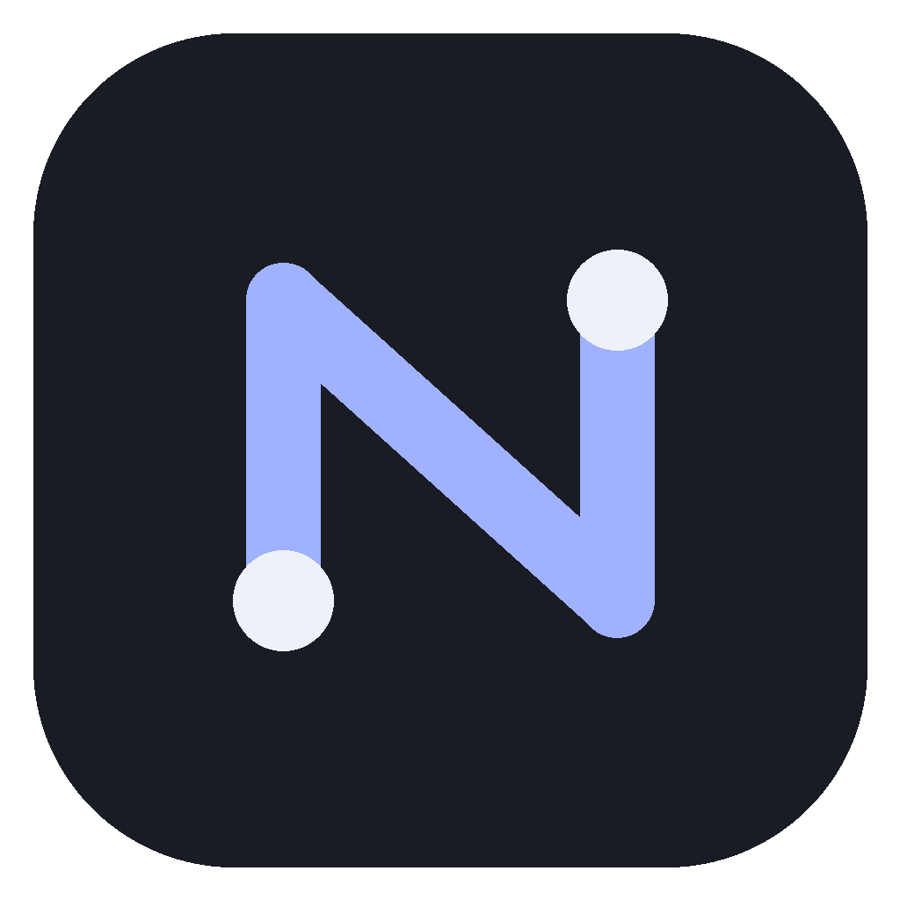
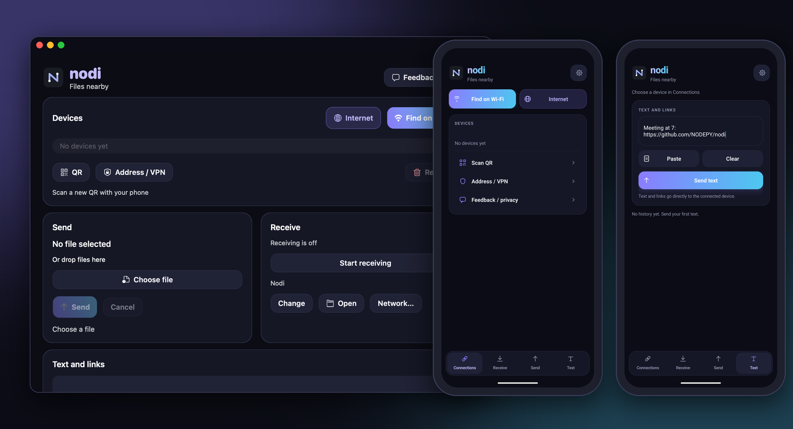
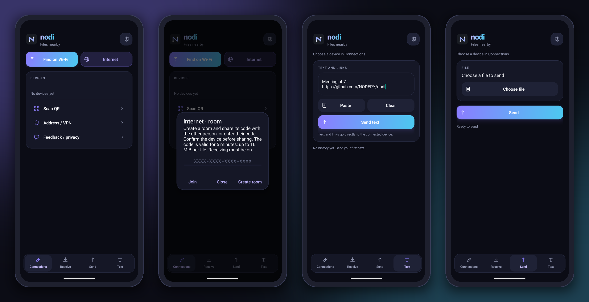
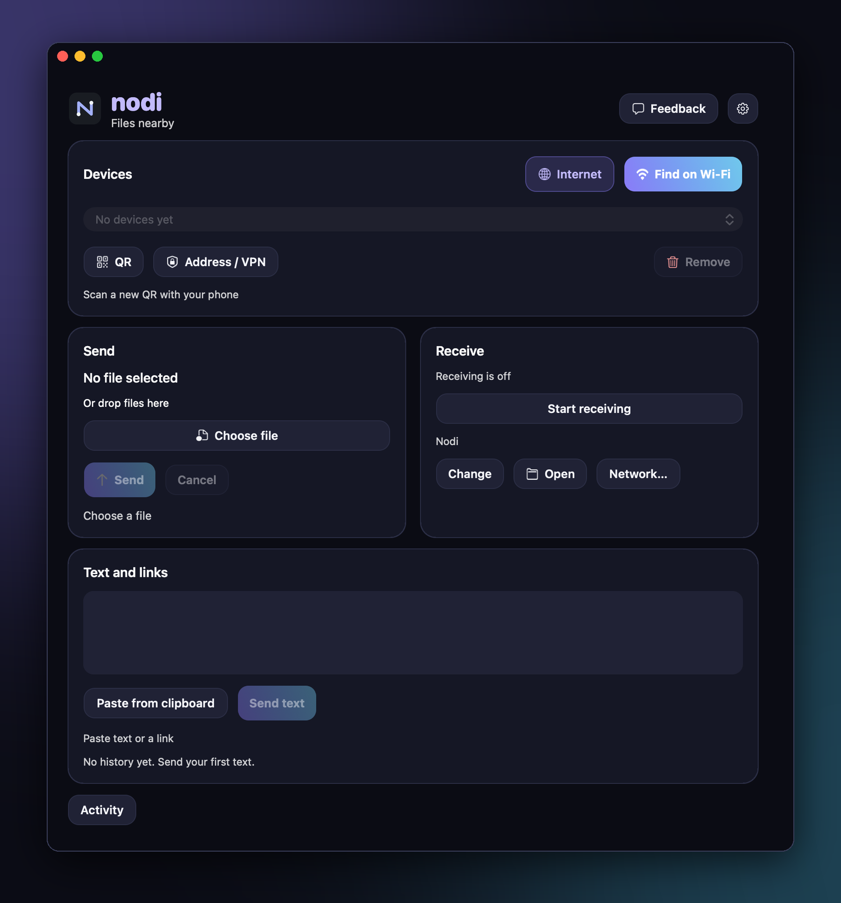
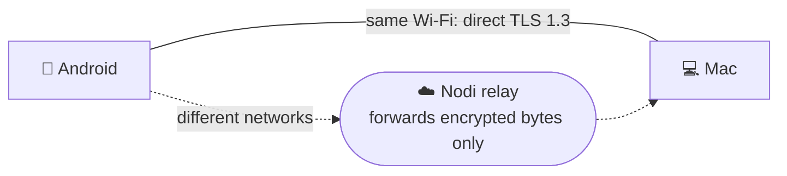

<div align="center">



# Nodi

**Send files, text and links between your Mac and Android — on the same Wi-Fi or across the Internet.**<br>
End-to-end encrypted. No accounts. No cloud storage.

<a href="https://nodi-relay.igor-shura2011faik.workers.dev/download/android"></a>
<a href="https://nodi-relay.igor-shura2011faik.workers.dev/download/macos"></a>

[](https://github.com/NODEPY/nodi/actions/workflows/go.yml)
[](https://github.com/NODEPY/nodi/actions/workflows/interop.yml)
[](https://github.com/NODEPY/nodi/releases)

[](LICENSE)

[Releases](https://github.com/NODEPY/nodi/releases) · [What's new](CHANGELOG.md) · [Internet rooms](docs/INTERNET-ALPHA.md) · [CLI](docs/CLI.md) · [Security](SECURITY.md)



</div>

## Why Nodi

<table>
<tr>
<td width="33%" valign="top">

### ⚡ Just send it
Find your phone on Wi-Fi, compare a short code, done. Files, clipboard text and links go straight to the other device.

</td>
<td width="33%" valign="top">

### 🌍 Works anywhere
On different networks? Create a **room**, share its 16-character code, approve. From then on Nodi picks Wi-Fi or the Internet by itself.

</td>
<td width="33%" valign="top">

### 🔒 Private by design
Pinned TLS 1.3 runs device-to-device, even through the relay. No account, no upload to a cloud drive, nothing to sign up for.

</td>
</tr>
</table>

## Screenshots



<details>
<summary><b>macOS</b></summary>
<br>

</details>

## How it works



1. **Pair once** — over Wi-Fi with a comparison code, by scanning the Mac's QR, or across networks with an Internet room that the host approves.
2. **Send** — Nodi tries a direct connection first and falls back to the relay only if that fails.
3. **Verify** — every transfer is pinned to the paired device's certificate and checked with SHA-256. Existing files are never overwritten.

## Quick start

1. Install Nodi on your Mac and Android phone.
2. **Same Wi-Fi:** tap **Find on Wi-Fi**, pick the other device and confirm the matching code on both screens.<br>
   **Different networks:** tap **Internet → Create room** on one device and **Join** with that code on the other.
3. On the receiving device choose a folder and turn on receiving. Pick files on the sender — or use the **Text** tab for snippets and links.

> [!TIP]
> Install the Android APK over an existing installation to keep your paired devices. The Mac app is not notarized yet: right-click `Nodi.app` → **Open** the first time.

## Features

| Connect | Transfer | Stay in control |
| --- | --- | --- |
| Wi-Fi discovery with code confirmation | Multiple files in a row, up to 2 GiB each on LAN | Approve every new device and room join |
| Internet rooms for pairing across networks | Automatic LAN or Internet route | Cancel a selection or a running transfer |
| QR pairing as an alternative | Text and links up to 64 KiB, copied to the clipboard | Remove saved devices at any time |
| Manual IPv4 / VPN route per device | **Share → Nodi** on Android, drag & drop on Mac | Opt-in statistics, off by default |

## Security and privacy

- Transfers use TLS 1.3 pinned to the paired device's certificate, plus a per-pair token. Discovery alone never grants trust.
- The Internet relay (a Cloudflare Worker) only forwards the encrypted stream. Its operator can see device IDs, IP addresses, timing and traffic size — not contents.
- Room codes are secrets: only a digest and an AES-256-GCM encrypted blob reach the server, and the host must approve the joining device.
- Usage statistics are off unless you enable them; then only daily pseudonymous counters are sent. The **Feedback** button sends your text to the author.
- No independent security audit yet. Please report issues as described in [SECURITY.md](SECURITY.md).

## Limitations

> [!NOTE]
> Nodi is an **alpha**. Over the Internet files are limited to 16 MiB and 10 minutes per session, receiving must stay on, and polling can add up to 10 seconds of delay. The relay currently accepts 64 device identities and 16 simultaneous transfers. There is no NAT traversal, offline delivery, folder transfer or resume. The Mac build is Apple Silicon only and ad-hoc signed; the Android build is debug-signed.

See [TESTING.md](TESTING.md) for known test gaps and the device checklist.

<details>
<summary><b>Pairing, receiving and sharing in detail</b></summary>

### Pairing and receiving
Open Nodi on both devices on the same LAN. Use **Find on Wi-Fi**, select the discovered peer and start connecting. Compare the displayed codes and approve on both screens. QR remains an alternative: show the Mac pairing QR and scan it on Android. On Android select a destination folder and enable receiving only when files are needed. On Mac the destination can be changed while the receiver is running; the receiver restarts.

### Internet rooms
When a direct TCP connection fails, paired devices automatically use the Cloudflare relay. To pair across networks, create a room in **Internet** on one device, share the 16-character code privately, join with it on the other device and approve the request on the host. Codes expire after five minutes. See [Internet alpha](docs/INTERNET-ALPHA.md) and the [relay server](server/cloudflare/README.md).

### Manual address / VPN
Pair devices first, connect your VPN, then select a saved device → **Address / VPN**. Enter the other receiver's IPv4 address and current port. This route is saved and used for both files and text; **Automatic** restores discovery-based routing. No new trust is granted by entering an address. See [setup and limits](docs/VPN-ADDRESS.md).

### Sharing from other apps
On Android, select one or more files in another app, choose **Share → Nodi**, then choose the paired device and tap **Send**. Text and links open the Text tab. On Mac, drop up to 100 regular files onto the Nodi window, then click **Send**. Folders are not supported. New shares/drops do not replace an active transfer.

</details>

<details>
<summary><b>Build from source</b></summary>

**macOS** — macOS 12+, Go 1.22+ and Xcode Command Line Tools:

```bash
bash scripts/run-macos.sh
```

The script prefers `MacOSX26.sdk` from Command Line Tools when installed (newer SDKs can be incompatible with the installed Swift), otherwise uses the `xcrun` default. Set `SDKROOT` to override it.

**Android** — minSdk 29, compileSdk/targetSdk 37. Open `android/` in Android Studio, or:

```bash
bash android/gradlew -p android assembleDebug
```

The APK is `android/app/build/outputs/apk/debug/app-debug.apk`.

**Checks**

```bash
go vet ./...
go test -race ./...
python3 scripts/check-core.py
bash android/gradlew -p tests/interop test --no-daemon
```

The last command runs the Kotlin ↔ Go transport integration tests (JDK 25, no Android SDK required). See the [CLI documentation](docs/CLI.md) for the Go command-line tool.

</details>

<details>
<summary><b>Versioning</b></summary>

The latest release is **1.0.0-alpha.7** (tag `v1.0.0-alpha.7`). Prereleases use `MAJOR.MINOR.PATCH-alpha.N`, stable releases `MAJOR.MINOR.PATCH`. Android `versionName` matches the release; `versionCode` increases for each distributed build (currently 7). macOS uses `CFBundleShortVersionString = 1.0.0` and `CFBundleVersion = 9`; increase the build number for each distributed build. Go **1.22** is the minimum toolchain in `go.mod`, not the app version.

</details>

## Roadmap

Windows and Linux apps · NAT traversal · offline delivery · folder transfer · resume

## License

Apache-2.0 — see [LICENSE](LICENSE).
